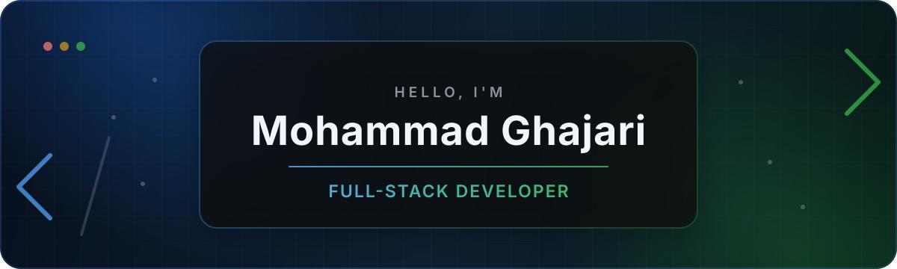

<div align="center">
  
</div>

<div align="center">
  <a href="mailto:ghajarimohammad057@gmail.com">
    
  </a>
  <a href="https://t.me/m_ghajari">
    
  </a>
  <a href="https://instagram.com/ghajari_mohammad29">
    
  </a>
  
</div>

<br />

## About me

I'm a Computer Engineering student at Ferdowsi University of Mashhad and a full-stack developer who enjoys turning complex ideas into clean, reliable products. I care about thoughtful interfaces, maintainable architecture, backend performance, and the small details that make software feel polished.

```javascript
const mohammad = {
  location: "Mashhad, Iran",
  education: "Computer Engineering @ Ferdowsi University of Mashhad",
  focus: ["Full-Stack Development", "Product Engineering", "Scalable Backends"],
  currentlyLearning: "A little more every day",
};
```

## Tech stack

<div align="center">

  **Frontend**

  

  **Backend & Data**

  

  **Languages & Tools**

  

</div>

## Featured projects

<table>
  <tr>
    <td width="50%" valign="top">
      <h3>🏨 <a href="https://github.com/MohammadGhajari/Luthien">Luthien</a></h3>
      <p>A full-stack hotel reservation experience, built around a smooth and practical booking flow.</p>
      
      
    </td>
    <td width="50%" valign="top">
      <h3>📚 <a href="https://github.com/MohammadGhajari/Galad">Galad</a></h3>
      <p>A React application for discovering, rating, and organizing books with the Google Books API.</p>
      
      
    </td>
  </tr>
  <tr>
    <td width="50%" valign="top">
      <h3>🔎 <a href="https://github.com/MohammadGhajari/Information-Retrieval-Project">Rank Tracker</a></h3>
      <p>A website analytics platform that tracks Google rankings for search queries using Selenium automation.</p>
      
    </td>
    <td width="50%" valign="top">
      <h3>💳 <a href="https://github.com/MohammadGhajari/Penny">Penny</a></h3>
      <p>A focused personal-finance application for keeping everyday transactions organized and manageable.</p>
      
    </td>
  </tr>
</table>

## GitHub activity

<div align="center">
  
</div>

<div align="center">
  
  
</div>

<div align="center">
  
</div>

<br />

<div align="center">
  <sub>Building useful things, one thoughtful commit at a time.</sub>
</div>
